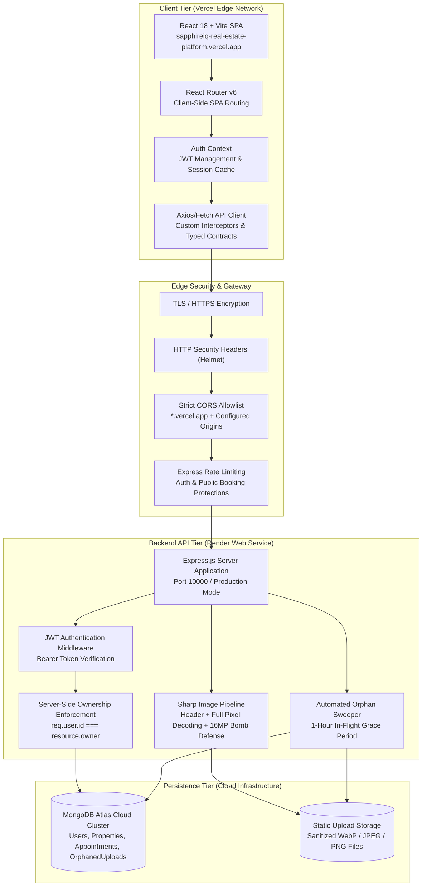

# SapphireIQ — Premium Full-Stack Real Estate Platform

[](https://sapphireiq-real-estate-platform.vercel.app/)
[](https://sapphireiq-real-estate-platform.onrender.com/api/health)
[](https://github.com/unknown404-practice/sapphireiq-real-estate-platform)
[](LICENSE)

SapphireIQ is an enterprise-grade full-stack real estate platform engineered with **React 18 + TypeScript**, **Node.js + Express + TypeScript**, and **MongoDB Atlas (Mongoose)**. The platform provides property exploration across major Indian metropolitan areas, multi-criteria filtering, verified image pipelines with full image buffer decoding, atomic multi-image rollback, booking workflows for both guest and authenticated users, and server-enforced role-based access control.

---

## 🌐 Live Production Deployments

| Resource | Target URL | Status | Description |
| :--- | :--- | :--- | :--- |
| **Frontend Web App** | [https://sapphireiq-real-estate-platform.vercel.app/](https://sapphireiq-real-estate-platform.vercel.app/) | `Live` | Single Page Application hosted on Vercel Edge Network |
| **Backend REST API** | [https://sapphireiq-real-estate-platform.onrender.com/](https://sapphireiq-real-estate-platform.onrender.com/) | `Live` | Node.js Express API service deployed on Render Web Service |
| **API Health Check** | [https://sapphireiq-real-estate-platform.onrender.com/api/health](https://sapphireiq-real-estate-platform.onrender.com/api/health) | `Active` | Production database readiness probe and uptime monitor |
| **GitHub Repository** | [https://github.com/unknown404-practice/sapphireiq-real-estate-platform.git](https://github.com/unknown404-practice/sapphireiq-real-estate-platform.git) | `Active` | Full-stack monorepo source code and audit test suite |

---

## 🔑 Pre-Configured Demo Credentials

The platform includes sample non-privileged accounts for local development and testing:

| Role | Email Address | Password | Permissions | Environment |
| :--- | :--- | :--- | :--- | :--- |
| **Standard User** | `user1@sapphireiq.local` | `Password123!` | Search properties, book viewings, view personal appointments | Local / Development Only |
| **Property Owner** | `user2@sapphireiq.local` | `Password123!` | Create, update, upload images, and manage property listings | Local / Development Only |

> [!NOTE]
> **Admin Account Provisioning:** Administrative credentials are never stored in source control or public documentation. To bootstrap a local administrator account, supply the `ADMIN_SEED_EMAIL` and `ADMIN_SEED_PASSWORD` environment variables before running the database seeder:
> ```bash
> ADMIN_SEED_EMAIL="your-admin@domain.com" ADMIN_SEED_PASSWORD="YourSecurePassword123!" npm run seed
> ```
> In production, administrative users must be provisioned through secure direct operations or dedicated administrative onboarding. Database seeding is strictly blocked in production (`NODE_ENV=production`).

---

## 🏛️ System Architecture & Data Flow



---

## 📂 Complete Project Directory Tree

```
sapphireiq-real-estate-platform/
├── .env.example                               # Root environment configuration template
├── .gitignore                                 # Git ignore rules for node_modules, dist, uploads, env
├── package.json                               # Monorepo root workspace configuration
├── package-lock.json                          # Monorepo dependency lockfile
├── README.md                                  # Project documentation, architecture, and live links
├── render.yaml                                # Render Infrastructure-as-Code deployment blueprint
├── vercel.json                                # Root Vercel SPA client rewrite rules
│
├── backend/                                   # Node.js + Express + TypeScript API Service
│   ├── .env.example                           # Backend environment variables template
│   ├── package.json                           # Backend dependencies, types, and build scripts
│   ├── tsconfig.json                          # TypeScript compiler settings for CommonJS build
│   ├── vitest.config.ts                       # Vitest automated test configuration
│   │
│   ├── src/                                   # Application source code
│   │   ├── app.ts                             # Express setup, Helmet, CORS, and root routes
│   │   ├── server.ts                          # Server entrypoint and graceful shutdown listeners
│   │   │
│   │   ├── config/                            # Core configuration
│   │   │   ├── database.ts                    # Mongoose database connection and disconnect logic
│   │   │   └── env.ts                         # Validated environment variables and production fallbacks
│   │   │
│   │   ├── controllers/                       # Request handlers and business logic
│   │   │   ├── appointmentController.ts       # Booking viewings (guest & authenticated)
│   │   │   ├── authController.ts              # Register, login, forgot password, reset password
│   │   │   └── propertyController.ts          # CRUD listings, filters, upload handlers, sweeps
│   │   │
│   │   ├── middleware/                        # Express middleware
│   │   │   ├── auth.ts                        # JWT validation and authenticated request hydration
│   │   │   ├── errorHandler.ts                # Sanitized error response formatter
│   │   │   └── rateLimiter.ts                 # Rate limiters for auth, properties, and bookings
│   │   │
│   │   ├── models/                            # Mongoose schemas and model definitions
│   │   │   ├── Appointment.ts                 # Viewing appointment schema & status constraints
│   │   │   ├── OrphanedUpload.ts              # Tracked abandoned files for safe async sweep
│   │   │   ├── Property.ts                    # Property schema, geocoding, pricing, and amenities
│   │   │   └── User.ts                        # User credentials, roles (user, admin), and bcrypt hash
│   │   │
│   │   ├── routes/                            # Route mappings
│   │   │   ├── appointmentRoutes.ts           # /api/appointments route definitions
│   │   │   ├── authRoutes.ts                  # /api/auth route definitions
│   │   │   ├── healthRoutes.ts                # /api/health probe route definition
│   │   │   ├── index.ts                       # Aggregated API router mount (/api/*)
│   │   │   └── propertyRoutes.ts              # /api/properties route definitions
│   │   │
│   │   ├── scripts/                           # Database automation scripts
│   │   │   └── seed.ts                        # Realistic Indian property catalog seeder
│   │   │
│   │   ├── services/                          # Application services
│   │   │   ├── emailService.ts                # Password reset emails via Nodemailer
│   │   │   └── imageService.ts                # Sharp decoding, magic byte check, rollback, sweeper
│   │   │
│   │   └── types/                             # TypeScript interfaces & custom request types
│   │       └── index.ts                       # AuthenticatedRequest, FileUploads, FilterParams
│   │
│   └── tests/                                 # Automated integration test suite
│       ├── setup.ts                           # In-memory MongoDB lifecycle runner
│       ├── health.test.ts                     # System probe and unknown route tests
│       ├── auth.test.ts                       # Registration, password hashing, and login tests
│       ├── properties.test.ts                 # Property CRUD and server authorization tests
│       ├── appointments.test.ts               # Guest and user viewing appointment tests
│       └── flaw_fixes.test.ts                 # 37 critical verification tests (Sharp, sweeper, rollback)
│
├── frontend/                                  # React 18 + Vite + Tailwind CSS Single Page App
│   ├── .env.example                           # Frontend environment template (VITE_API_BASE_URL)
│   ├── index.html                             # Single page HTML entrypoint
│   ├── package.json                           # Frontend dependencies and Vite build scripts
│   ├── postcss.config.js                      # PostCSS plugins for Tailwind CSS
│   ├── tailwind.config.js                     # Tailwind UI theme, color palette, and extensions
│   ├── tsconfig.json                          # TypeScript configuration for React JSX and Vite bundler
│   ├── tsconfig.node.json                     # TypeScript config for Vite configuration files
│   ├── vercel.json                            # Vercel SPA catch-all rewrite to /index.html
│   ├── vite.config.ts                         # Vite configuration, dev proxy, and build settings
│   │
│   ├── public/                                # Public web assets
│   │   ├── robots.txt                         # Search engine crawler policies
│   │   └── sitemap.xml                        # XML sitemap for SEO discovery
│   │
│   └── src/                                   # Frontend source code
│       ├── App.tsx                            # React Router v6 setup with React.lazy code splitting
│       ├── index.css                          # Tailwind CSS imports and custom global styling
│       ├── main.tsx                           # React DOM root bootstrap
│       ├── vite-env.d.ts                      # Vite client environment typing
│       │
│       ├── components/                        # Modular React components
│       │   ├── Footer.tsx                     # Global footer with navigation links
│       │   ├── Navbar.tsx                     # Header with auth state, profile toggle, and logo
│       │   ├── PropertyCard.tsx               # Reusable card for listing display with badges
│       │   ├── ProtectedRoute.tsx             # Authentication guard redirecting unauthenticated users
│       │   └── ViewingModal.tsx               # Modal dialogue for booking viewing appointments
│       │
│       ├── context/                           # Global state providers
│       │   └── AuthContext.tsx                # JWT token persistence, user profile, and auth methods
│       │
│       ├── pages/                             # Lazy-loaded page views
│       │   ├── CreateEditPropertyPage.tsx     # Property creation & editing form with image uploader
│       │   ├── DashboardPage.tsx              # User dashboard managing owned listings & bookings
│       │   ├── ForgotPasswordPage.tsx         # Password reset request form
│       │   ├── HomePage.tsx                   # Landing page with hero banner and featured properties
│       │   ├── LoginPage.tsx                  # User and admin sign-in form
│       │   ├── NotFoundPage.tsx               # 404 error page with navigation fallbacks
│       │   ├── PropertiesPage.tsx             # Search, filter, and pagination listings catalog
│       │   ├── PropertyDetailPage.tsx         # Comprehensive property specs, photo gallery, contact
│       │   ├── RegisterPage.tsx               # New user onboarding form
│       │   └── ResetPasswordPage.tsx          # Password token reset confirmation form
│       │
│       ├── services/                          # API communication layer
│       │   └── api.ts                         # Type-safe client wrapping all backend REST endpoints
│       │
│       ├── types/                             # Frontend TypeScript type declarations
│       │   └── index.ts                       # Property, User, Appointment, and Filter interfaces
│       │
│       └── utils/                             # Utility helpers
│           └── formatters.ts                  # Indian Rupee (INR ₹), Lakh/Crore, and date formatters
│
└── docs/                                      # Technical documentation & security audit ledgers
    ├── adr.md                                 # Architecture Decision Records
    ├── agent-progress.md                      # Development milestones and verification ledger
    ├── ANTIGRAVITY_HIDDEN_FLAW_AUDIT.md       # Initial vulnerability identification report
    ├── FINAL_INDEPENDENT_VERIFICATION_AUDIT.md# Formal audit report covering all 67 test verifications
    ├── QA_CRITICAL_01_BOUNDARY_AUDIT.md       # Input validation and boundary test documentation
    └── QA_CRITICAL_02_LIFECYCLE_AUDIT.md      # Upload lifecycle and orphan sweeper verification
```

---

## 🔒 Security & Verification Highlights

1. **Full Image Decoding & Decompression Defense**:
   - Every uploaded image is verified via magic bytes (file signature) **and** decoded through `sharp` to inspect actual pixel dimensions and color channels.
   - Enforces strict dimension constraints (max 4096×4096 px, max 16 Megapixels, max 5MB) to defend against memory exhaustion and decompression bomb attacks.
2. **Atomic Multi-Image Upload Rollback**:
   - If a failure occurs while processing or writing any file in a multi-image batch, previously written files are immediately rolled back and purged from storage.
3. **Resilient Orphan Sweeper & In-Flight Grace Period**:
   - The automated reconciliation worker (`reconcileDiskOrphans`) maintains a 1-hour grace window for newly uploaded files, ensuring legitimate users filling out forms are never disrupted while safely harvesting abandoned uploads.
4. **Server-Enforced Authorization**:
   - Property edits, deletions, and appointment cancellations strictly verify server-side ownership (`req.user.id === resource.owner`). Client-supplied owner fields are rejected.
5. **Multi-Origin CORS Protection**:
   - Dynamically checks origins against configured production hosts and matches trusted Vercel preview environments (`https://*.vercel.app`) without opening wildcards.

---

## 🛠️ API Reference Summary

### System Health
- `GET /api/health` — Returns database connectivity status, uptime, and service health.

### Authentication (`/api/auth`)
- `POST /api/auth/register` — Creates user account with bcrypt password hashing.
- `POST /api/auth/login` — Authenticates credentials and issues signed JWT.
- `GET /api/auth/me` — Fetches current user profile from bearer token.
- `POST /api/auth/forgot-password` — Dispatches password reset tokens.
- `POST /api/auth/reset-password` — Validates reset token and updates password.

### Properties (`/api/properties`)
- `GET /api/properties` — Paginated catalog with multi-field filtering (`city`, `propertyType`, `listingType`, `price`, `bedrooms`).
- `GET /api/properties/:id` — Retrieves comprehensive property details.
- `POST /api/properties` — Creates new property listing (Authenticated).
- `PATCH /api/properties/:id` — Modifies listing (Owner/Admin restricted).
- `DELETE /api/properties/:id` — Deletes listing (Owner/Admin restricted).
- `POST /api/properties/upload-images` — Multipart upload (Max 4 images, 5MB each, validated with Sharp).
- `GET /api/properties/user/mine` — Retrieves all listings owned by current user.

### Appointments (`/api/appointments`)
- `POST /api/appointments/guest` — Rate-limited public viewing booking.
- `POST /api/appointments` — Authenticated appointment reservation.
- `GET /api/appointments/mine` — Lists user bookings and owner requests.
- `PATCH /api/appointments/:id/cancel` — Cancels appointment (Booker/Owner authorized).

---

## 💻 Local Development Setup

### 1. Prerequisites
- **Node.js**: v18.0.0 or higher
- **npm**: v9.0.0 or higher
- **MongoDB**: Local MongoDB instance or MongoDB Atlas URI

### 2. Installation
```bash
# Clone the repository
git clone https://github.com/unknown404-practice/sapphireiq-real-estate-platform.git
cd sapphireiq-real-estate-platform

# Install root, backend, and frontend dependencies
npm install
```

### 3. Environment Setup
Configure `backend/.env` and `frontend/.env` based on their respective `.env.example` files:

```bash
# Backend (.env)
PORT=4000
MONGODB_URI=mongodb://localhost:27017/sapphireiq
JWT_SECRET=your_super_secret_jwt_key_at_least_32_characters_long
APP_ORIGIN=http://localhost:5173

# Frontend (.env)
VITE_API_BASE_URL=http://localhost:4000/api
```

### 4. Seed Database & Run
```bash
# Seed database with sample Indian properties & demo users
npm run seed

# Run both backend and frontend development servers concurrently
npm run dev:backend   # Runs on http://localhost:4000
npm run dev:frontend  # Runs on http://localhost:5173
```

### 5. Running Automated Tests
```bash
npm run test
```
*Executes all 67 integration tests across 5 test suites using Vitest and MongoDB Memory Server.*

---

## 👤 Author & Maintainer Credentials

- **Lead Engineer & Author:** Ranadeep Saha
- **Email:** [ranadeep2021saha@gmail.com](mailto:ranadeep2021saha@gmail.com)
- **LinkedIn:** [www.linkedin.com/in/ranadeep-saha-a03296404](https://www.linkedin.com/in/ranadeep-saha-a03296404)
- **GitHub:** [@unknown404-practice](https://github.com/unknown404-practice)
